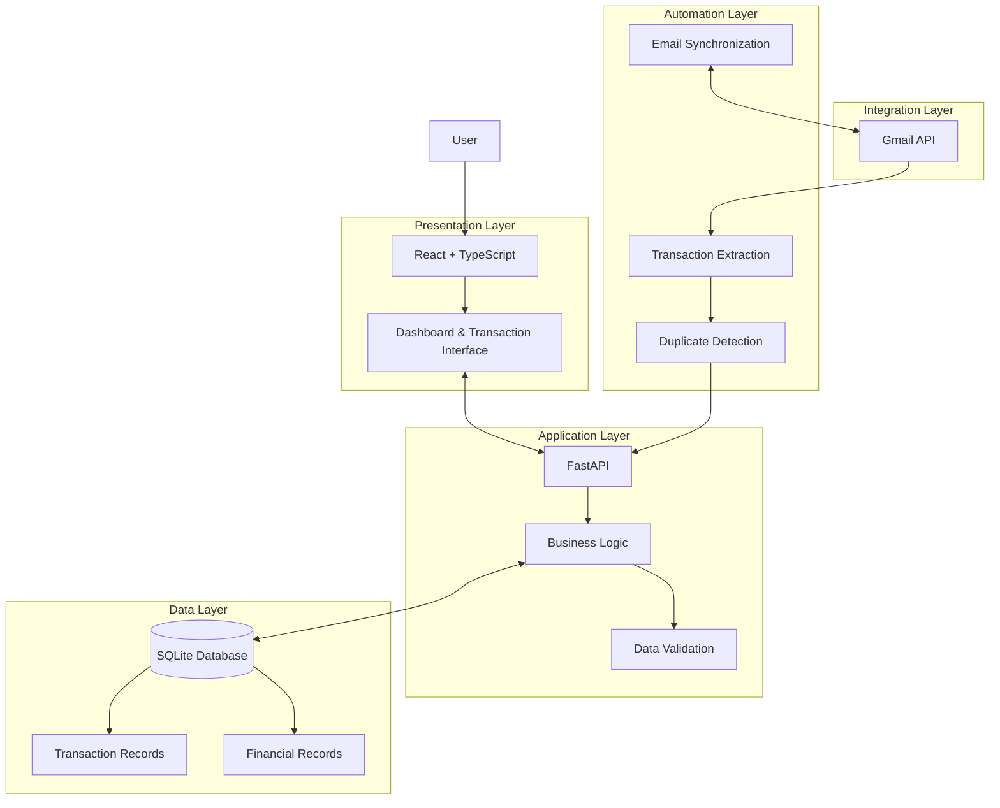
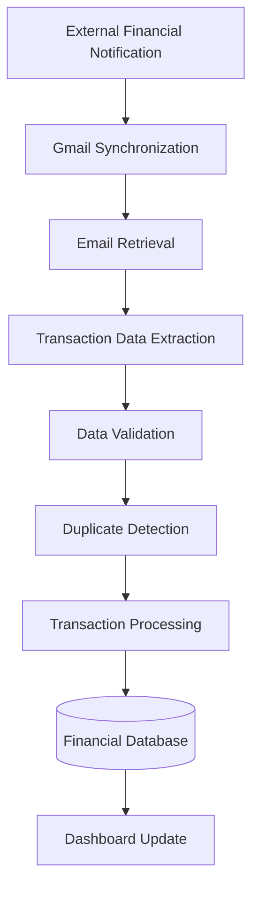

# Zero Vault — System Architecture

<p align="center">
  <strong>Technical Architecture & System Design</strong>
</p>

---

## 1. Introduction

Zero Vault is a modular personal finance management system designed to centralize financial information, automate transaction collection, and provide structured financial insights.

The application follows a client-server architecture, separating the presentation layer, application logic, data persistence, and external service integrations.

The architecture is designed to support future expansion into automated financial synchronization across Japanese banking institutions, credit cards, and mobile payment platforms.

### Architectural Objectives

- Modular and maintainable application design.
- Separation of frontend and backend responsibilities.
- Reliable financial data persistence.
- Extensible external service integrations.
- Secure handling of sensitive financial information.
- Scalable transaction processing workflows.

---

## 2. High-Level Architecture

Zero Vault consists of five primary architectural components:

1. Presentation Layer
2. Application Layer
3. Data Layer
4. Integration Layer
5. Automation Layer

### System Architecture Diagram



The frontend communicates with the backend through API endpoints. The backend processes application requests and manages persistent financial records.

External integrations operate through dedicated synchronization and data-processing workflows.

---

## 3. Presentation Layer

**Technology: React + TypeScript**

The presentation layer provides the primary user interface.

Its responsibility is to present financial information in an organized and accessible format.

### Responsibilities

- Financial dashboard rendering.
- Transaction visualization.
- Income and expense presentation.
- User interaction management.
- Communication with backend APIs.
- Displaying financial summaries.

### Design Principles

- Component-based architecture.
- Reusable UI components.
- Clear separation of presentation and application logic.
- Consistent financial data visualization.
- Responsive interface design.

---

## 4. Application Layer

**Technology: Python + FastAPI**

The application layer acts as the central processing component of Zero Vault.

It receives frontend requests, executes business logic, validates financial data, and communicates with the database.

### Responsibilities

- API request handling.
- Financial record management.
- Transaction processing.
- Input validation.
- Database operations.
- Integration coordination.

### Request Lifecycle

```text
Frontend Request
       |
       v
   API Endpoint
       |
       v
 Request Validation
       |
       v
 Business Logic
       |
       v
 Database Operation
       |
       v
 Response Generation
       |
       v
 Frontend Update
```

The backend provides a controlled interface between the frontend and the underlying financial data.

---

## 5. Data Layer

**Technology: SQLite**

SQLite provides persistent storage for application data.

The data layer is responsible for maintaining structured financial records and supporting reliable retrieval and updates.

### Conceptual Data Categories

| Data Category | Purpose |
|---|---|
| Transactions | Income and expense records |
| Financial Accounts | Financial account information |
| Categories | Transaction classification |
| Synchronization Records | External data synchronization tracking |
| Application Settings | Application configuration |

### Data Management Objectives

- Consistent financial records.
- Reliable database operations.
- Structured transaction storage.
- Prevention of duplicate records.
- Data integrity.

The database design is intended to evolve as additional financial integrations are introduced.

---

## 6. Integration Layer

The integration layer connects Zero Vault with external financial information sources.

### Current Integration Direction

**Gmail API**

Gmail integration is designed to identify financial transaction information contained in supported email notifications.

Potential information includes:

- Transaction amount.
- Transaction date.
- Merchant information.
- Transaction description.
- Payment notification details.

The extracted information is processed before being incorporated into the application's financial records.

### Future Integration Targets

| Service | Integration Objective |
|---|---|
| ゆうちょ銀行 | Bank transaction synchronization |
| Rakuten Bank | Financial account synchronization |
| SMBC | Bank transaction synchronization |
| Credit Cards | Card transaction collection |
| PayPay | Mobile payment transaction collection |
| ICOCA | Transit and payment activity |

These integrations are planned capabilities, subject to provider access, API availability, and authorization requirements.

---

## 7. Automation Layer

The automation layer reduces the need for repetitive manual transaction entry.

### Transaction Processing Workflow



### Processing Stages

**Stage 1 — Data Collection**

Retrieve supported financial notifications from the connected email source.

**Stage 2 — Information Extraction**

Identify relevant financial information from the notification.

**Stage 3 — Validation**

Validate extracted values and required transaction fields.

**Stage 4 — Duplicate Detection**

Check whether the transaction has already been processed.

**Stage 5 — Persistence**

Store validated transaction information in the database.

**Stage 6 — Financial Visualization**

Make processed information available to the dashboard and transaction interface.

---

## 8. Data Flow Architecture

Zero Vault handles financial information through a controlled processing pipeline.

```text
        FINANCIAL DATA
               |
               v
       DATA COLLECTION
               |
               v
        DATA EXTRACTION
               |
               v
          VALIDATION
               |
               v
       DUPLICATE CHECK
               |
               v
       DATABASE STORAGE
               |
               v
      FINANCIAL ANALYTICS
               |
               v
        USER DASHBOARD
```

This structure separates external data collection from financial record management.

It also provides a foundation for introducing additional financial data sources.

---

## 9. Security Architecture

Security is an important architectural consideration because the application handles sensitive financial information.

### Security Considerations

**Credential Protection**
- Avoid storing credentials directly in application source code.
- Use environment-based configuration.
- Protect external service authorization tokens.

**API Security**
- Validate incoming requests.
- Restrict access to protected operations.
- Apply appropriate authentication and authorization controls.

**Data Protection**
- Avoid exposing personal financial records.
- Protect database files and backups.
- Minimize unnecessary financial data collection.

**Integration Security**
- Use authorized access methods.
- Protect synchronization credentials.
- Handle API failures safely.

Security mechanisms will evolve alongside the application's integration capabilities.

---

## 10. Architectural Design Principles

Zero Vault follows several core engineering principles.

| Principle | Implementation Objective |
|---|---|
| Modularity | Separate application responsibilities |
| Maintainability | Keep components independently manageable |
| Extensibility | Support additional financial integrations |
| Data Integrity | Maintain consistent financial records |
| Automation | Reduce repetitive manual operations |
| Privacy | Minimize unnecessary data exposure |
| Reliability | Handle synchronization and processing failures |

---

## 11. Future Architectural Evolution

The long-term architecture is intended to support multiple financial data providers.

### Planned Evolution

**Current Architecture**

```text
React Frontend
      |
FastAPI Backend
      |
SQLite Database
      |
Gmail Integration
```

**Target Architecture**

```text
       FINANCIAL DATA SOURCES

    +---------+---------+---------+
    |         |         |         |
   Banks   Cards     PayPay    ICOCA
    |         |         |         |
    +---------+---------+---------+
                  |
                  v
          INTEGRATION ENGINE
                  |
                  v
          DATA PROCESSING
                  |
                  v
            FASTAPI
                  |
          +-------+-------+
          |               |
          v               v
       DATABASE       ANALYTICS
          |               |
          +-------+-------+
                  |
                  v
            REACT UI
                  |
                  v
             USER
```

The target architecture represents a development direction rather than a claim that all integrations are currently operational.

---

## 12. Conclusion

Zero Vault is designed as an extensible personal finance management platform.

Its architecture separates user interaction, application processing, data persistence, and external integrations into distinct components.

This approach provides a foundation for expanding from basic financial tracking into automated financial data collection and centralized financial intelligence.

**The long-term objective is to create a unified financial management experience for users navigating multiple financial services.**

---

<p align="center">
  <strong>ZERO VAULT</strong>
  <br>
  One Vault. Complete Financial Visibility.
</p>