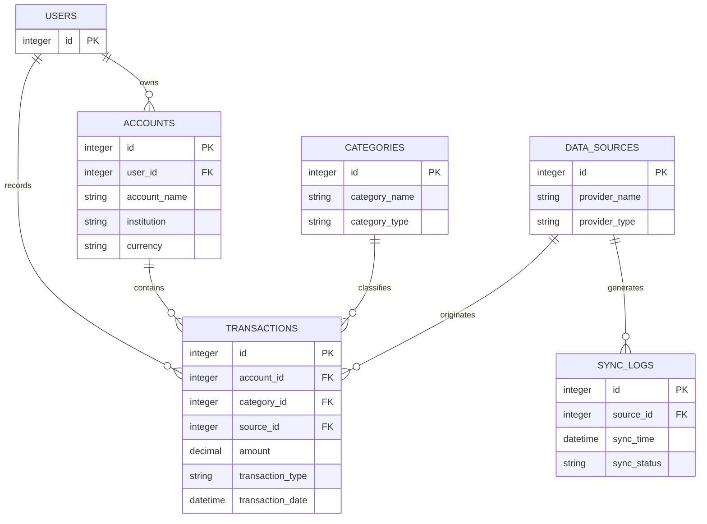

# Zero Vault — Database Design

**Database Architecture | Data Modeling | Integrity Strategy**

---

## 1. Database Overview

Zero Vault uses SQLite as its primary persistence layer.

The database is responsible for maintaining financial records, organizing transactions, and providing structured data for application operations.

The design prioritizes:

- Data consistency.
- Reliable transaction storage.
- Referential integrity.
- Efficient financial queries.
- Duplicate prevention.
- Future integration compatibility.

## 2. Database Design Principles

| Principle | Objective |
|---|---|
| Normalization | Reduce unnecessary data duplication |
| Integrity | Maintain valid relationships |
| Consistency | Preserve accurate financial records |
| Extensibility | Support additional financial providers |
| Traceability | Identify transaction origins |
| Reliability | Protect stored financial information |

## 3. Conceptual Data Model

The conceptual model identifies the primary entities required by a centralized financial management application.

*This is a proposed logical model, not a verified representation of the current SQLite schema.*

## 4. Core Entities

### Accounts

Represents financial accounts managed through Zero Vault.

Potential attributes:

- Account identifier.
- Account name.
- Financial institution.
- Account type.
- Currency.
- Creation timestamp.

### Transactions

Represents individual financial activities.

Potential attributes:

- Transaction identifier.
- Account reference.
- Transaction amount.
- Transaction type.
- Transaction date.
- Merchant information.
- Description.
- Category reference.
- Data source reference.

### Categories

Organizes transactions into meaningful financial classifications.

Examples:

- Food.
- Transportation.
- Shopping.
- Housing.
- Utilities.
- Entertainment.

### Data Sources

Identifies where financial information originated.

Examples:

- Manual entry.
- Gmail notification.
- Bank integration.
- Credit card integration.
- Mobile payment integration.

### Synchronization Logs

Maintains information about external data synchronization operations.

Potential attributes:

- Source identifier.
- Synchronization timestamp.
- Processing status.
- Number of records processed.
- Error information.

## 5. Transaction Data Integrity

Financial records require careful handling to avoid incorrect totals and duplicate entries.

### Recommended Rules

1. Every transaction must have a valid amount.
2. Every transaction must have an interpretable date.
3. Transaction types must use controlled values.
4. Account references must remain valid.
5. Imported records should retain source information.
6. Duplicate detection should use stable provider identifiers whenever available.

### Financial Precision

Financial amounts should use integer minor units or an appropriate decimal representation rather than binary floating-point arithmetic.

For example:

| Display Value | Stored Value |
|---|---:|
| ¥1,500 | 1500 |
| ¥2,350 | 2350 |
| ¥10,000 | 10000 |

## 6. Database Relationships

The logical model establishes these relationships:

- One user can manage multiple accounts.
- One account can contain multiple transactions.
- One category can classify multiple transactions.
- One data source can originate multiple transactions.
- One data source can generate multiple synchronization records.

These relationships support centralized financial record management.

## 7. Query and Performance Strategy

Potential optimization techniques include:

- Indexing transaction dates.
- Indexing account references.
- Indexing category references.
- Using indexed provider transaction identifiers.
- Limiting unnecessary full-table scans.
- Using database transactions for multi-step writes.

## 8. Future Database Evolution

As Zero Vault expands, the database may require additional entities for:

- Budgets.
- Recurring transactions.
- Financial goals.
- Account balances.
- Merchant records.
- Categorization rules.
- Provider synchronization checkpoints.

Any schema changes should preserve existing financial records and maintain migration compatibility.

## 9. Conclusion

The database design provides a logical foundation for centralized financial data management.

By separating accounts, transactions, categories, and external data sources, Zero Vault can evolve toward a multi-provider financial platform while maintaining structured and consistent financial records.

---

**ZERO VAULT**

One Vault. Complete Financial Visibility.